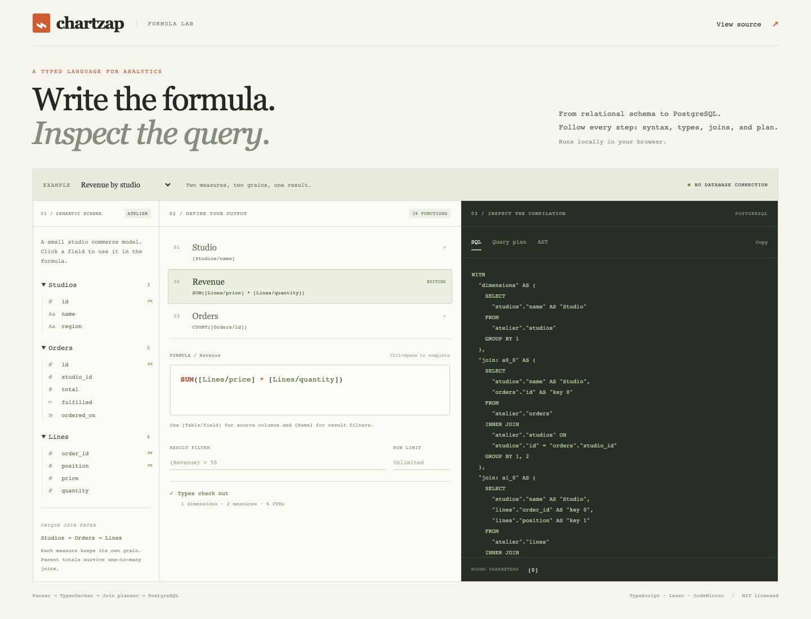
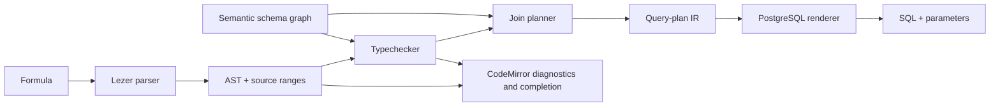

# Chartzap

**A typed formula language that plans relational analytics and compiles to PostgreSQL.**

Write `SUM([Lines/price] * [Lines/quantity])`, choose a dimension from a related table,
and inspect the AST, diagnostics, join plan, and SQL. Chartzap preserves each
measure’s grain, so joining order lines does not multiply order totals.



Try the formula lab locally:

```sh
git clone https://github.com/nickpad/chartzap.git
cd chartzap
pnpm install --frozen-lockfile
pnpm build
pnpm dev
```

Open the address printed by Vite. Select an example, edit a formula, click schema
fields to use them, or switch between SQL, query plan, and AST. Compilation runs
in the browser; no database, account, or backend is needed.

## Five-minute example

The repository contains three ESM workspace packages. They are intentionally
private on npm; this release is distributed through GitHub. Run this example in
the cloned workspace with `pnpm example` after building.

```ts
import { createSchemaGraph, createFormulaEngine } from "@chartzap/core";
import { postgres } from "@chartzap/postgres";

const graph = createSchemaGraph({
  relations: [
    {
      schema: "public",
      name: "sales",
      primaryKeys: ["id"],
      columns: [
        { name: "id", type: "number" },
        { name: "region", type: "text" },
        { name: "amount", type: "number" },
      ],
    },
  ],
  graphNodes: [{ name: "Sales", relation: "public.sales" }],
  graphEdges: [],
});
const engine = createFormulaEngine({ graph });
const result = engine.compileQuery({
  columns: [
    { name: "Region", formula: "[Sales/region]" },
    { name: "Revenue", formula: "SUM([Sales/amount])" },
  ],
  filter: "{Revenue} > 100",
  compiler: postgres(),
});
if (result.ok) {
  console.log(result.plan); // Typed query-plan IR
  console.log(result.sql); // { text: 'WITH ... $1::numeric ...', parameters: [100] }
} else {
  console.log(result.diagnostics); // code, message, from, to, optional column
}
```

Every API receives its schema explicitly. `checkColumn()` and `checkFilter()`
expose typechecking without SQL; `compileAST()` exposes the AST; `buildQueryPlan()`
and `renderPostgres()` expose the planner and renderer independently.
See [the public API](docs/api.md) and [the original Atelier example](examples/atelier).
For use outside this workspace, [pack and install local tarballs](docs/releases.md).

## Pipeline



| Package                      | Responsibility                                                                        |
| ---------------------------- | ------------------------------------------------------------------------------------- |
| `@chartzap/core`             | Grammar, AST, 39 function specifications, schema graph, typechecking, compiler facade |
| `@chartzap/postgres`         | Join planning, CTE-based IR, parameterized PostgreSQL rendering                       |
| `@chartzap/codemirror`       | Language, completions, semantic highlighting, function focus, lint adapter            |
| `@chartzap/codemirror/react` | Optional React 19 editor wrapper                                                      |

The headless packages have no dependency on React, CodeMirror, a web framework,
a database driver, or any running service. [Architecture](docs/architecture.md)
explains the boundaries; [query planning](docs/query-planning.md) explains grain
preservation and join semantics.

## Language

- Columns: `[Orders/total]`; result filters: `{Revenue} > 100`.
- Numbers, double-quoted text, booleans, parentheses, arithmetic, comparisons,
  `AND`, `OR`, and `//` comments.
- Aggregates: `Sum`, `Avg`, `Count`, distinct counts, min/max, median, mode,
  percentile, and conditional variants.
- Text: concatenation, casing, matching, and split parts.
- Dates: construction, date arithmetic, date parts, and today.
- Logic and numbers: `If`, `Not`, `IsNull`, `Coalesce`, absolute value, ceiling,
  floor, and truncation.

[Syntax and all functions](docs/formula-language.md) includes exact precedence,
escaping, supported types, and diagnostic behavior.

## Deliberate limits

- PostgreSQL only. Compilation is separate from database execution.
- The schema is a **semantic model**, with one join path between any connected
  pair of nodes. Cycles and self edges are rejected with `AMBIGUOUS_JOIN_PATH`.
  Disconnected tables cannot be combined into a dimension query.
- The planner does not yet alias two physical tables with the same name in one
  query scope. The graph can represent semantic roles; the compiler rejects a
  query that needs unsupported table aliases.
- Each aggregate must refer to columns from one semantic node. Measures cannot
  mix bare columns with aggregates. No window functions, arbitrary SQL, or
  aggregates over scalars.
- Dimensions use inner joins; missing dimension relationships omit rows. Final
  measures use left joins against the dimension result. Null semantics follow
  PostgreSQL. Ordering ties have no implicit row-ID tiebreaker.
- No authentication, connection management, caching, persistence, charting,
  ingestion, or SQL dialect portability.

SQL scalar values are bound parameters with explicit types. Schema identifiers
and output IDs are quoted with doubled quotes; output IDs must fit PostgreSQL’s
63-byte identifier limit. There is **no implicit result limit**; supply a
nonnegative integer `limit` when needed. The low-level literal renderer is for
inspection; use `renderPostgres()` for execution.

## Development

Node 22 and 24 are tested in CI; pnpm 10 is used with a committed lockfile.
There are no package install-time scripts.

```sh
pnpm generate          # Regenerate the checked-in Lezer parser
pnpm format:check
pnpm lint
pnpm build             # ESM and declarations, in dependency order
pnpm typecheck
pnpm test              # Includes the migrated 264-test unit baseline
pnpm exec playwright install chromium --only-shell
pnpm test:browser      # React rendering, completion, highlighting, cleanup
pnpm test:packages     # Fresh tarball consumer, runtime exports, declarations
pnpm build:playground
```

For real PostgreSQL execution checks, use the isolated database setup in
[CONTRIBUTING.md](CONTRIBUTING.md). CI also checks generated-file reproducibility,
PostgreSQL results, and secrets. Supported versions are limited to those actually
exercised by the CI matrix; see [release policy](docs/releases.md).

## Project

Extracted from a working SaaS BI product by Nick Dainty. This repository contains
its framework-independent analytical engine and editor integrations, with a new
public API and examples. The private application and its history are excluded.
See [provenance and third-party notices](THIRD_PARTY_NOTICES.md).

[MIT](LICENSE) · [Contributing](CONTRIBUTING.md) · [Security](SECURITY.md) ·
[Changelog](CHANGELOG.md) · [Release process](docs/releases.md)
